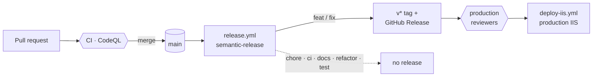
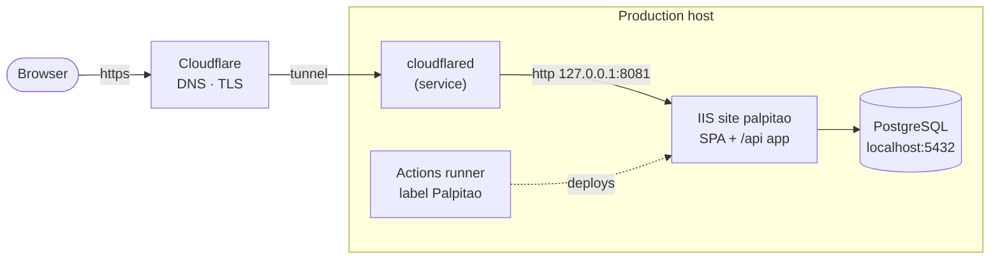

# Operations

How the app is built, released, deployed and watched, and how secrets stay out of the repository.

## Continuous integration and deployment



GitHub Actions workflows live in `.github/workflows/`:

| Workflow | Trigger | What it does |
|---|---|---|
| `ci.yml` | every pull request + push to `main` | Backend build, tests with coverage, EF model-drift check; frontend format check, lint, build, unit and e2e; workflow lint (actionlint) |
| `codeql.yml` | pull requests, `main`, weekly | CodeQL security analysis of C#, TypeScript and the workflows themselves |
| `release.yml` | push to `main` | **semantic-release**: tag + GitHub Release, then deploys **production** |
| `deploy-iis.yml` | called by `release.yml` (+ manual) | Builds + deploys to **production** (reusable) |
| `reset-db.yml` | manual | Wipes the production database except one super-admin (typed confirmation) |
| `seed-group.yml` | manual | Creates the first group for that super-admin (typed confirmation) |

There is **no staging environment** (removed in November 2026): production is the only deployed
one. Try risky changes against a local Postgres copy of production first.

Dependabot (`.github/dependabot.yml`) opens monthly, grouped minor/patch updates for NuGet, npm and
Actions; framework majors are upgraded deliberately.

### Branch / PR flow

`main` is the single source of truth (trunk-based). Work on a feature branch, open a PR to `main`,
let CI go green, then merge. Merging into `main` runs **semantic-release**: based on the
[Conventional Commits](https://www.conventionalcommits.org/) since the last release (`feat` → minor,
`fix` → patch, `BREAKING CHANGE` → major) it decides the next version, tags it and — if there's
something to release — deploys that tag to **production**. Commits with no user-facing change
(`chore`, `ci`, `docs`, `refactor`, `test`) tag nothing and deploy nothing. To enforce the PR flow, enable a
branch ruleset on `main` (Settings → Branches): *Require a pull request before merging* and *Require
status checks to pass* (the `Backend`, `Frontend` and `Lint workflows (actionlint)` checks from
`ci.yml`).

### Production host

Production is one Windows machine on the owner's network that runs everything: IIS, PostgreSQL,
the GitHub Actions runner and the Cloudflare Tunnel. Nothing listens on the internet: the public
hostname is a **Cloudflare Tunnel**, so Cloudflare terminates TLS and `cloudflared` (a Windows
service) forwards to the IIS site on a loopback-only binding.



| Piece | Setting |
|---|---|
| Frontend IIS path | `C:\inetpub\palpitao` (repo variable `FRONTEND_IIS_PATH`) |
| Backend IIS path | `C:\inetpub\palpitao\api`, an IIS application under the site (`BACKEND_IIS_PATH`) |
| App pool | `palpitao-api`, *No Managed Code* (`BACKEND_APP_POOL`) |
| Site binding | `http 127.0.0.1:8081` — loopback only; the tunnel is the one way in |
| Database | PostgreSQL on `localhost:5432`, database `palpitao`, owned by role `palpitao` |
| Runner | repository runner with the label **`Palpitao`** — every self-hosted job asks for `[self-hosted, Palpitao]`, so a second runner can never pick up a deploy |

What the machine needs besides IIS: the **ASP.NET Core Hosting Bundle** (same major as the app),
**IIS URL Rewrite** (the SPA's `web.config` falls back to `index.html` with it), the
**IIS Management Scripts and Tools** feature (the deploy stops/starts the app pool through the
`WebAdministration` module, and only warns without it), the .NET SDK and Node on the runner
service's `PATH`, and sleep disabled on AC power. The runner service and `cloudflared` start
automatically, so a reboot brings the site back on its own.

Behind the tunnel every request reaches the API from `127.0.0.1`, so the per-IP auth rate limit
buckets every client together until the API reads Cloudflare's `CF-Connecting-IP` header.

**Moving the host** to another machine: prepare the pieces above there, register a runner with a
temporary label, then put the site offline (`app_offline.htm` in the old `api` folder), copy the
database with `pg_dump -Fc` / `pg_restore --no-owner`, compare `scripts/db-counts.sql` on both sides,
point the `production` environment's `BACKEND_CONNECTION_STRING` at the new database, move the
`Palpitao` label to the new runner, run *Build and deploy on IIS Production* by hand, install
`cloudflared` there with the existing tunnel's token, and stop `cloudflared` on the old machine — two
connectors on one tunnel would split traffic between both hosts. Keep the old machine stopped, not
wiped, until the new one has run a few days.

### Releases & production deployment (`release.yml` + `deploy-iis.yml`)

Releases are **automatic** via [semantic-release](https://semantic-release.gitbook.io/). On each push
to `main` it analyses the Conventional Commits since the last `v*` tag, computes the next version,
creates the **git tag + GitHub Release** (the Release notes are your changelog), and then the
`deploy-production` job builds that tag and deploys it to the `production` environment. The app
**footer shows the version** — read at build time from the latest git tag (`git describe`), so prod
shows the released `v*` (a manual deploy of a branch shows the last release plus the short commit).

You don't bump versions by hand: just merge Conventional Commits and semantic-release does the rest.
It does **not** push a commit back to `main` (no bump commit), so it works with branch protection and
needs no PAT. `deploy-iis.yml` is a **reusable** workflow (`workflow_call`) invoked by `release.yml`;
you can also run it manually (**Actions → Build and deploy on IIS Production → Run workflow**,
optionally passing a `ref`) as a fallback. It targets the `production` environment and its secrets
(`BACKEND_CONNECTION_STRING`, `JWT_ISSUER`, `JWT_AUDIENCE`, `JWT_KEY`) and the production IIS paths.

The `production` environment can require a reviewer: with that protection rule on, the release run
waits for approval before `deploy-iis.yml` touches the server. EF Core migrations are applied
**before** the new build is copied in, so the schema is never behind the code, and a failing
migration fails the deploy while the old version keeps serving.

## Secrets and security hardening

This repository is public: **never** commit real secrets. The versioned files
(`appsettings*.json`, `.env.example`) carry only **placeholders**.

- Don't commit `.env` (already ignored); use the `*.env.example` files as a reference.
- The real connection string, `Jwt:Key`, `Sentry:Dsn` and `Fixtures:ApiKey` must come from
  **environment variables**, user-secrets (`dotnet user-secrets`) or GitHub Secrets — never from
  the code. In production the deploy workflow generates `appsettings.Production.json` from GitHub
  secrets.
- Don't commit `*.traineddata` (Tesseract models), uploads, local databases (`*.db`) or
  screenshots/images with real data.
- The development admin (`admin@palpitao.local`) is **development only**. A database built by the
  migrations starts with it and its published password; outside Development the API logs an error at
  startup (so Sentry raises it) until that password is changed.

### Hardening in the code

Beyond secret hygiene, the backend applies defence-in-depth controls:

- **Auth rate limiting** — `login` / `register` / `create-group` / `refresh` are throttled per client
  IP (`RateLimiting:Auth`, default 20/min) to blunt brute-force / credential stuffing. Behind a reverse
  proxy, forward the real client IP so the limiter doesn't bucket everyone under the proxy.
- **Defence-in-depth multi-tenant isolation** — besides `CurrentGroupService` (the access chokepoint),
  an EF Core **global query filter** scopes every `IGroupOwned` root (Season, Round, Standing,
  RoundParticipantResult, SeasonScoringConfig, OcrParticipantAlias) to the request group, and `SaveChanges` **stamps** the current group on inserts that left `GroupId`
  unset — so a forgotten filter or assignment can't leak/misplace another group's data. Inert outside an
  HTTP request (background refresh, seeding, tests).
- **Unified password policy** — 8+ chars with at least one letter and one digit, enforced on public
  registration, public create-group **and** admin-created participants (`Palpitao.Domain/Common/PasswordPolicy`).
- **Atomic scoring** — round scoring / season recalculation run inside a DB transaction.
- **Single-runner background refresh** — when scaled out, only the instance holding a Postgres advisory
  lock refreshes results each cycle (no duplicate external calls / write races).
- **Resilient external calls** — fixture/results HTTP clients retry transient failures (5xx/408/429,
  connection errors) with bounded backoff.
- **Consistent errors** — every error is an RFC 7807 problem carrying a `traceId` for log/Sentry
  correlation; health
  endpoints don't leak exception types or migration names.

### The self-hosted runner and a public repository

Deploys need IIS, so they run on a **self-hosted** Windows runner that also holds the production
secrets. Workflows triggered by pull requests run on GitHub-hosted runners only, but a pull request
from a fork could add a workflow of its own that asks for `self-hosted`. The repository therefore has
to keep **Settings → Actions → General → Fork pull request workflows → Require approval for all
external contributors**, so nothing from outside runs before an owner has read it.

## Monitoring with Sentry

The backend integrates the official `Sentry.AspNetCore` SDK to capture unhandled exceptions,
`Error`/`Critical` logs, breadcrumbs of important actions and safe request context. The application
keeps working normally when the DSN is empty.

Base configuration (`backend/src/Palpitao.Api/appsettings*.json`):

```json
"Sentry": {
  "Dsn": "",
  "Environment": "Development",
  "Release": "palpitao-backend@1.0.0",
  "TracesSampleRate": 0.0,
  "Debug": false,
  "SendDefaultPii": false,
  "MinimumBreadcrumbLevel": "Information",
  "MinimumEventLevel": "Error"
}
```

In production, prefer environment variables or host/IIS secrets:

```env
SENTRY_DSN=
SENTRY_ENVIRONMENT=Production
SENTRY_RELEASE=palpitao-backend@1.0.0
SENTRY_TRACES_SAMPLE_RATE=0.0
SENTRY_DEBUG=false
```

Never commit a real DSN or any secret. To disable event delivery, leave `SENTRY_DSN` empty. To
enable performance tracing, raise `SENTRY_TRACES_SAMPLE_RATE` gradually (e.g. `0.05` for 5% of
transactions); `0.0` keeps tracing off.

Data sent: exception, error level/log, route, HTTP method, traceId, environment, release,
breadcrumbs without sensitive payload and, when authenticated, the user id, the email already
present in the JWT and a role tag (`user.role`). The SDK runs with `SendDefaultPii=false`.

Data filtered before sending: `Authorization`, cookies, tokens/JWT, passwords, `PasswordHash`,
password confirmation, DSN, connection strings, uploaded files and the full OCR text. The global
middleware still returns friendly, localized problems and puts the `traceId` on every error
response, so a user's report can be matched to the log line and the Sentry event. Expected 4xx
failures (validation, not found, business rules) never become Sentry events — only Error log lines
do, and those come from unexpected failures.

Local Sentry test:

1. Set `SENTRY_DSN` in the development environment.
2. Run the backend in `Development`.
3. Authenticate as admin.
4. Call `GET /admin/sentry/test-error` (or `/api/admin/sentry/test-error` if the API is mounted as
   the `/api` application in IIS).

That endpoint returns 404 outside `Development` and requires admin.

## Database maintenance

`scripts/` holds the SQL the maintenance workflows run (through the file-based app
`scripts/run-sql.cs`, so the runner needs nothing but the .NET SDK) and the same scripts for a GUI
client:

- `reset-db-keep-admin.sql` — wipes application data but one super-admin (and optionally the groups it
  owns), schema-version tolerant, one atomic `DO` block that rolls back if the admin is not found.
- `seed-group-for-admin.sql` — creates a first group for that admin; does nothing if it already has one.
- `delete-group.sql`, `delete-season.sql`, `delete-rounds.sql` — targeted deletes that default to a
  **dry run** and print row counts; `db-counts.sql` shows the counts before and after.
- `rehearsal/` — a seeded, already-played season scored through the real API, to rehearse a season
  by hand against a local or throwaway database — **never production**.
